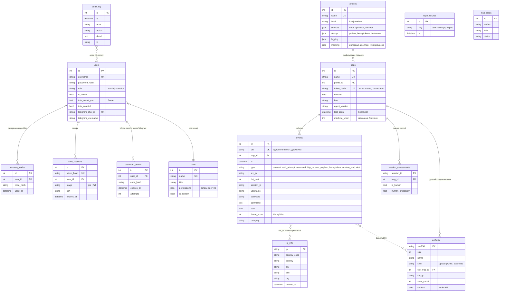

# Схема базы данных центра

PostgreSQL, база `honeyforge` (SQLite — для локального запуска). Таблицы создаются при старте центра (`app/db.py: init_db`),
модели — `backend/center/app/models.py`. Оркестратор ведёт собственную базу `orchestrator` (телеметрия и статистика).

## Поток данных

1. Оператор создаёт `profiles` и `traps` (токен агента показывается один раз, в БД лежит только SHA-256).
2. Агент раз в `beacon_interval` (с джиттером) читает `/assets/v1/manifest.json` — это heartbeat (`traps.last_seen`) и выдача конфигурации по профилю.
3. События агента (`/assets/v1/log`, шифруются AES-256-GCM) попадают в `events`. Дубликаты отсекаются по `uid`.
4. В той же транзакции: правило алерта (≥N попыток входа за окно → событие `alert`), файлы (`data.sha256`) → `artifacts`.
5. Фоном: геолокация/ASN → `ip_info`, оценка HoneyMind → поля `threat_score`/`category`, итог сессии → `session_assessments`.
6. Центр публикует событие в WebSocket `/api/ws/events` (лента панели), алерты и honeytoken уходят в Telegram.
